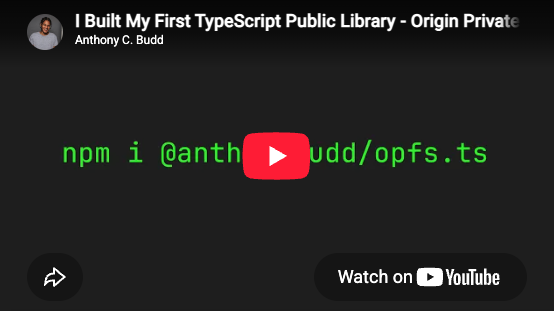
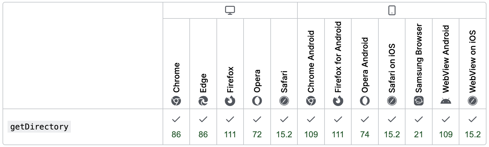

# OPFS.ts


A minimal TypeScript API for the [Origin Private File System](https://developer.mozilla.org/en-US/docs/Web/API/File_System_API/Origin_private_file_system) using `fs` function names.

OPFS is a browser-based file system that allows web applications to store files privately on a user's device, without requiring access through a native file picker. It provides file operations through a JavaScript API making it perfect for applications that need persistent local storage for images, binaries and large files.

- 📘 [Documentation](/docs/globals.md)
- ✅ Full Test Coverage
- ☁️ Installable with NPM

```sh
npm install @anthonybudd/opfs.ts
```

<p align="center">
  <a href="https://youtu.be/abU2lA6QzDI">
  
  </a>
  </br>
  <a href="https://youtu.be/abU2lA6QzDI">
  Getting Started: youtu.be/abU2lA6QzDI
  </a>
</p>

### Getting Started

```ts
import opfs from '@anthonybudd/opfs.ts';

await opfs.mkdir('/personal/notes');
await opfs.write('/personal/notes/test.txt', 'Hello World');
await opfs.exists('/personal/notes/test.txt');
await opfs.unlink('/personal/notes/test.txt');
await opfs.readDir('/personal/notes');

for await (const [path, handle] of opfs.walkDir('/personal/notes')) {
  console.log(path, handle.kind);
}

await opfs.observe('/personal/notes/test.txt', (records, observer) => {
  for (const record of records) {
    console.log('Change detected:', record);
  }
});
```

### Documentation

Full documentation is available in [docs](docs/globals.md)

### Browser Support

OPFS is widely supported across all major modern web browsers, including Chrome, Firefox, and Safari.


[Source: developer.mozilla.org](https://developer.mozilla.org/en-US/docs/Web/API/StorageManager/getDirectory#browser_compatibility)

### Tests

Unit tests and browser integration tests are provided in `test/`.

```sh
npm run test:unit
npm run test:browser
```

### Contributing

If you feel like contributing to the project, please do! Bug fixes, enhancements etc. are always welcome.

### License

OPFS.ts is licensed under the Apache 2.0 license. See [LICENSE](LICENSE) for more.
